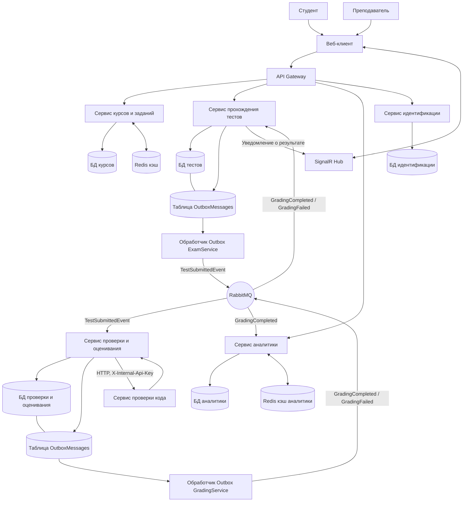
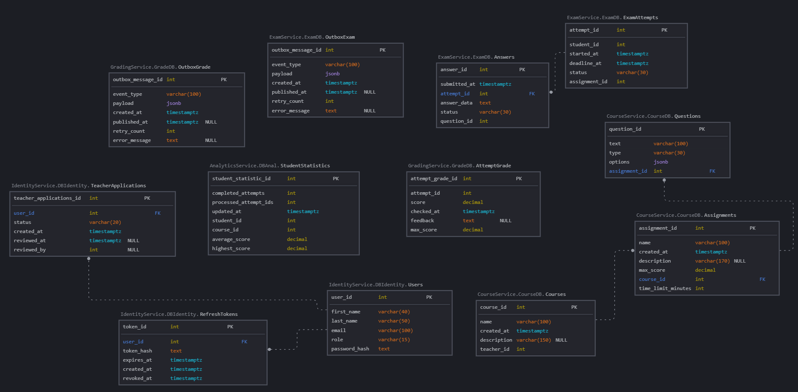

# Архитектура системы


## 1. Цель и контекст


Онлайн-тестирование и проверка заданий.

Система предназначена для автоматизации процесса обучения и контроля знаний в колледжах и университетах. Она решает задачу организации проверки знаний: преподаватели создают курсы, тесты и задания, а студенты проходят их в онлайн-формате.


## 2. Требования


Функциональные требования:

1\. Курсы, теория и задания: преподаватель имеет возможность создавать курсы, учебные материалы (теорию) и задания для студентов, а студенты - изучать материал и проходить тесты.

2\. Прохождение тестов: студент имеет возможность проходить тесты для проверки знаний и отправлять ответы на проверку, система должна обеспечивать контроль времени прохождения теста на серверной стороне.

3\. Проверка и оценивание: система должна проверять ответы студентов, рассчитывать оценку и сохранять результаты. Проверка должна поддерживать асинхронную обработку через RabbitMQ.

4\. Автопроверка кода: при наличии программного кода в задании система должна проверять код в изолированном процессе или контейнере.

5\. Аналитика: система должна собирать данные студента о результатах его тестов и составлять статистику успеваемости.

6\. Хранение данных: для каждого микросервиса должна быть своя база данных.

7\. Взаимодействие сервисов: синхронные HTTP-запросы от веб-клиента должны проходить через API Gateway. Асинхронный обмен заданиями на проверку и результатами проверки должен осуществляться через RabbitMQ.


Нефункциональные требования:

1\. Надежность: система должна корректно обрабатывать ошибки между микросервисами. Если сервис проверки временно недоступен, сообщения с заданиями на проверку должны оставаться в очереди RabbitMQ до возможности обработки.

2\. Безопасность: API должно поддерживать проверку JWT-токенов для защиты от несанкционированного доступа.

3\. Целостность данных: ответы студентов и результаты проверки должны сохраняться в соответствующих базах данных. Повторная обработка одного задания не должна создавать дублирующие результаты.

4\. Журналирование: система должна записывать основные события работы микросервисов и ошибки в журналы, чтобы облегчить поиск неисправностей.

5\. Контроль состояния: каждый микросервис должен предоставлять endpoint для проверки работоспособности.

6\. Развертывание: система должна запускаться с помощью Docker Compose. Инструкция по запуску должна быть описана в README.

7\. Тестируемость: основные функции системы должны проверяться автоматическими тестами, включая прохождение тестов, проверку ответов и обработку сообщений через RabbitMQ.


## 3. Общая схема





## 4. Описание сервисов


[API-контракты](api-contracts.md)


## 5. Модель данных





## 6. Взаимодействие сервисов


В системе используются синхронное взаимодействие по HTTP и асинхронный обмен событиями через RabbitMQ.

Веб-клиент отправляет HTTP-запросы через API Gateway. Gateway направляет запросы в соответствующие сервисы:


CourseService - получение курсов и заданий

ExamService - начало тестирования, сохранение ответов и отправка теста на проверку

AnalyticsService - получение статистики

IdentityService - регистрация, вход и получение данных для аутентификации


Каждый сервис работает со своей базой данных.

Проверка отправленных тестов выполняется асинхронно с помощью RabbitMQ.

1\. ExamService сохраняет ответы и информацию об отправке теста в ExamDB.

2\. Событие TestSubmittedEvent записывается в таблицу OutboxMessages.

3\. Фоновый обработчик отправляет событие в RabbitMQ.

4\. GradingService получает событие, проверяет ответы и сохраняет результат в GradeDB.

5\. GradingService публикует событие GradingCompleted или GradingFailed через свой Outbox.

6\. ExamService обновляет статус попытки, а AnalyticsService использует полученный результат для обновления статистики.

7\. После завершения проверки клиент может получить уведомление через SignalR Hub.


```mermaid

sequenceDiagram

&#x20;   actor Student as Студент

&#x20;   participant Client as Веб-клиент

&#x20;   participant Exam as ExamService

&#x20;   participant MQ as RabbitMQ

&#x20;   participant Grade as GradingService

&#x20;   participant SignalR as SignalR Hub


&#x20;   Student->>Client: Отправить тест

&#x20;   Client->>Exam: Передать ответы

&#x20;   Exam->>Exam: Сохранить ответы

&#x20;   Exam-->>Client: Тест принят


&#x20;   Exam->>MQ: TestSubmittedEvent

&#x20;   MQ->>Grade: Передать тест

&#x20;   Grade->>Grade: Проверить ответы

&#x20;   Grade->>MQ: GradingCompleted

&#x20;   MQ->>Exam: Передать результат

&#x20;   Exam->>Exam: Обновить статус попытки

&#x20;   Exam->>SignalR: Уведомить о готовности результата

&#x20;   SignalR-->>Client: Результат готов

```

## 7. Безопасность


Для защиты системы предусмотрены следующие механизмы:


Аутентификация: IdentityService отвечает за вход пользователя и проверку его учётных данных.

Хранение паролей: в базе данных хранится хеш пароля, а не исходный пароль.

Роли: предусмотрены роли Student, Teacher и Admin. Студент проходит тесты и видит свои результаты, преподаватель управляет своими курсами, теорией, заданиями и оценками, администратор управляет пользователями и заявками на роль преподавателя. Доступ к операциям ограничивается на стороне сервера.

Защита API: защищённые запросы должны проверять токен аутентификации и права пользователя.

Защита данных: каждый микросервис имеет собственную базу данных. Между сервисами передаются необходимые идентификаторы и данные событий.

Изоляция запуска кода: пользовательский код запускается в изолированной среде, чтобы ограничить его воздействие на систему.


## 8. Развёртывание и конфигурация

Вся система запускается одной командой `docker compose up --build`. В состав окружения входят:

- `web-client` — веб-клиент, порт 5000;
- `api-gateway` — API Gateway, порт 5006;
- `identity-service`, `course-service`, `exam-service`, `grading-service`, `analytics-service`;
- `code-execution-service` — изолированная проверка кода, порт 5203;
- `postgres` — СУБД, порт 5432; у каждого сервиса своя база данных;
- `rabbitmq` — брокер сообщений, порты 5672 и 15672 (Management UI);
- `redis` — кэш, порт 6379.

Каждый микросервис использует собственную базу данных. Прямой доступ одного сервиса к базе данных другого не предусмотрен: общение идёт через HTTP или события.

Секреты (JWT-ключ, пароли БД, внутренний ключ CodeExecutionService) передаются через переменные окружения из `.env`; в репозитории хранится только `.env.example`. Каждый сервис предоставляет endpoint `/health`, а контейнеры — health checks. RabbitMQ Management UI используется для просмотра состояния очередей и сообщений.


## 9. Принятые решения (ADR)


| Решение | Альтернативы | Причина выбора |
|---|---|---|
| 1. Передавать отправленные тесты в GradingService через RabbitMQ | Выполнять проверку непосредственно в HTTP-запросе | Асинхронная обработка позволяет не заставлять студента ждать завершения проверки в рамках одного запроса |
| 2. Использовать SignalR для уведомления клиента о готовности результата проверки | Использовать периодические запросы клиента к серверу | Это позволяет сообщать клиенту о готовности результата без постоянных запросов |
| 3. Использовать Outbox для публикации событий | Отправлять сообщения непосредственно в RabbitMQ после сохранения данных | Outbox снижает риск потери события при сбое между сохранением данных и отправкой сообщения |
| 4. Использовать JsonElement для Options.Question | Использовать JsonDocument для Options.Question | Он не требует освобождения ресурсов через Dispose(), в отличие от JsonDocument |
| 5. Использовать отдельный DTO для лимита времени прохождения теста | Использовать `[FromBody] int` | DTO подстраивается под привычный формат JSON-объекта, в отличие от простых типов |
| 6. Выполнять код студентов в отдельном CodeExecutionService | Запускать код внутри процесса GradingService | Отдельный сервис изолирует недоверенный код, позволяет ограничить CPU, память, число процессов и время выполнения, а также не роняет основной процесс проверки |
| 7. Использовать ProcessCodeRunner внутри контейнера в Docker-стеке | Требовать Docker-демон внутри контейнера (Docker-in-Docker) | Docker-сокет не пробрасывается в контейнер, поэтому сборка и запуск выполняются внутри самого контейнера CodeExecutionService с ограничениями ресурсов; на хосте остаётся DockerCodeRunner |
| 8. Кэшировать курсы, вопросы и аналитику в Redis | Каждый раз читать данные из PostgreSQL | Кэш снижает нагрузку на БД и ускоряет страницы курсов и аналитики; инвалидация выполняется при изменении данных |


## 10. Ограничения и развитие

Ограничения:

- Проверка кода выполняется синхронно внутри HTTP-запроса студента; отдельная очередь для неё не используется.
- В Docker-стеке код запускается внутри контейнера CodeExecutionService (`CodeRunner=process`), без вложенного Docker.
- SignalR-хаб доступен через API Gateway (`/hubs/grading`), но веб-клиент пока не подписан на события и обновляет результаты запросом.
- Веб-клиент статический: без сборки frontend-фреймворка.

Что можно улучшить:

- Вынести проверку кода в отдельную очередь RabbitMQ и добавить повторные попытки.
- Подключить веб-клиент к SignalR для мгновенного показа результатов.
- Добавить экспорт результатов и расширенную аналитику по вопросам.
- Покрыть интеграционными тестами сценарии RabbitMQ и CodeExecutionService.

