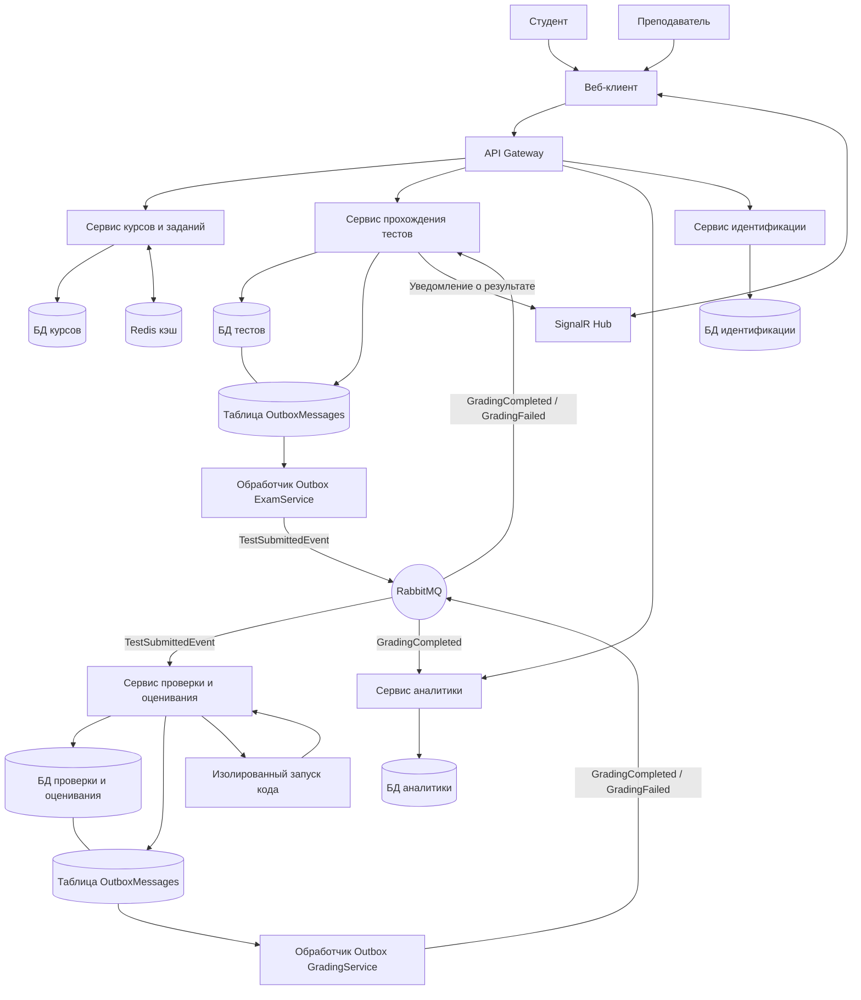

# Архитектура системы


## 1. Цель и контекст


Онлайн-тестирование и проверка заданий.

Система предназначена для автоматизации процесса обучения и контроля знаний в колледжах и университетах. Она решает задачу организации проверки знаний: преподаватели создают курсы, тесты и задания, а студенты проходят их в онлайн-формате.


## 2. Требования


Функциональные требования:

1\. Курсы и задания: преподаватель имеет возможность создавать курсы и задания для студентов, а студенты - изучать материал.

2\. Прохождение тестов: студент имеет возможность проходить тесты для проверки знаний и отправлять ответы на проверку, система должна обеспечивать контроль времени прохождения теста на серверной стороне.

3\. Проверка и оценивание: система должна проверять ответы студентов, рассчитывать оценку и сохранять результаты. Проверка должна поддерживать асинхронную обработку через RabbitMQ.

4\. Автопроверка кода: при наличии программного кода в задании система должна проверять код в изолированном процессе или контейнере.

5\. Аналитика: система должна собирать данные студента о результатах его тестов и составлять статистику успеваемости.

6\. Хранение данных: для каждого микросервиса должна быть своя база данных.

7\. Взаимодействие сервисов: синхронные HTTP-запросы от веб-клиента должны проходить через API Gateway. Асинхронный обмен заданиями на проверку и результатами проверки должен осуществляться через RabbitMQ.


Нефункциональные требования:

1\. Надежность: система должна корректно обрабатывать ошибки между микросервисами. Если сервис проверки временно недоступен, сообщения с заданиями на проверку должны оставаться в очереди RabbitMQ до возможности обработки.

2\. Безопасность: API должно поддерживать проверку JWT-токенов для защиты от несанкционированного доступа.

3\. Целостность данных: ответы студентов и результаты проверки должны сохраняться в соответствующих базах данных. Повторная обработка одного задания не должна создавать дублирующие результаты.

4\. Журналирование: система должна записывать основные события работы микросервисов и ошибки в журналы, чтобы облегчить поиск неисправностей.

5\. Контроль состояния: каждый микросервис должен предоставлять endpoint для проверки работоспособности.

6\. Развертывание: система должна запускаться с помощью Docker Compose. Инструкция по запуску должна быть описана в README.

7\. Тестируемость: основные функции системы должны проверяться автоматическими тестами, включая прохождение тестов, проверку ответов и обработку сообщений через RabbitMQ.


## 3. Общая схема





## 4. Описание сервисов


CourseService


Ответственность

Сервис отвечает за управление учебными курсами, заданиями и учебными материалами. Преподаватель может создавать и редактировать курсы и задания, а студент - просматривать доступные учебные материалы.


Основные эндпоинты

GET /api/courses - получение списка курсов

GET /api/courses/{id} - получение информации о курсе

POST /api/courses - создание курса

PUT /api/courses/{id} - изменение курса

GET /api/courses/{id}/assignments - получение заданий курса

POST /api/courses/{id}/assignments - создание задания.

GET /api/assignments/{id} - получение информации о задании.

PUT /api/assignments/{id} - изменение задания


База данных

CourseDB - хранит информацию о курсах, заданиях и учебных материалах


Публикуемые события RabbitMQ

Нет

Потребляемые события RabbitMQ

Нет


ExamService


Ответственность

Сервис отвечает за прохождение тестов студентами, сохранение ответов и контроль времени выполнения. Он фиксирует начало и завершение попытки прохождения теста, а также передаёт ответы на проверку через RabbitMQ. Контроль времени прохождения теста выполняется на сервере.


Основные эндпоинты

POST /api/attempts - попытка прохождения теста

GET /api/attempts/{id} - получение информации о попытке

POST /api/attempts/{id}/answers - сохранение ответов студента

POST /api/attempts/{id}/submit - завершение попытки и отправка ответов на проверку

GET /api/attempts/{id}/results - получение результатов проверки попытки. Если проверка ещё выполняется, API возвращает информацию о текущем статусе проверки.


База данных

ExamDB - хранит попытки прохождения тестов, ответы студентов и сведения о времени начала и завершения попыток


Публикуемые события RabbitMQ

TestSubmittedEvent - ответы отправлены на проверку

Событие должно содержать идентификатор попытки, идентификатор студента, ответы студента, ID задания и данные, необходимые для проверки.


Потребляемые события RabbitMQ

GradingCompleted - проверка успешно завершена. Событие содержит идентификатор попытки, полученную оценку и статус проверки. 

GradingFailed - проверка завершилась ошибкой. Событие содержит идентификатор попытки и информацию об ошибке. 


GradingService


Ответственность: Асинхронная автопроверка ответов студентов, запуск и изолированная проверка программного кода в Docker-песочнице, вычисление итогового балла.


Своя БД: DBGrade


Основные эндпоинты:

Публичные эндпоинты отсутствуют


Публикуемые события:

GradingCompleted - проверка успешно завершена. Событие содержит идентификатор попытки, полученную оценку и статус проверки. Его получают ExamService и AnalyticsService.

GradingFailed - проверка завершилась ошибкой. Событие содержит идентификатор попытки и информацию об ошибке.


Потребляемые события:

TestSubmittedEvent - содержит отправленные студентом ответы и необходимые для проверки данные. GradingService получает событие из очереди, выполняет проверку и вычисляет оценку.


AnalyticsService


Ответственность

Сбор статистических данных по успеваемости студентов, средней сложности тестов, динамике прохождения курсов и формирование аналитических отчетов.


Своя БД: DBAnal


Основные эндпоинты:

GET /api/analytics/students/{studentId} - получение статистики успеваемости конкретного студента

GET /api/analytics/courses/{courseId} - получение сводной аналитики по курсу для преподавателя


Публикуемые события: Нет


Потребляемые события:

GradingCompleted - получение сведений об успешных попытках, включая идентификаторы студента и задания, оценку и статус проверки. На основании этих данных AnalyticsService обновляет статистику успеваемости и аналитику.


IdentityService


Ответственность: отвечает за регистрацию, вход, выдачу JWT и хранение пользователей и ролей.


Своя БД: DBIdentity


Основные эндпоинты:

POST /api/auth/login - вход (роль определяется по пользователю)

POST /api/auth/register - регистрация

POST /api/auth/refresh - обновление JWT-токена

GET /api/users - получение списка пользователей с возможностью фильтрации по роли. Доступ разрешён пользователям с соответствующими правами.

GET /api/users/{id} - получение профиля пользователя. Доступ к данным ограничивается правами пользователя и его ролью.


Публикуемые события:

Нет


Потребляемые событие:

Нет


## 5. Модель данных


!\[ER-диаграмма](er-diagram.png)


## 6. Взаимодействие сервисов


В системе используются синхронное взаимодействие по HTTP и асинхронный обмен событиями через RabbitMQ.

Веб-клиент отправляет HTTP-запросы через API Gateway. Gateway направляет запросы в соответствующие сервисы:


CourseService - получение курсов и заданий

ExamService - начало тестирования, сохранение ответов и отправка теста на проверку

AnalyticsService - получение статистики

IdentityService - регистрация, вход и получение данных для аутентификации


Каждый сервис работает со своей базой данных.

Проверка отправленных тестов выполняется асинхронно с помощью RabbitMQ.

1\. ExamService сохраняет ответы и информацию об отправке теста в ExamDB.

2\. Событие TestSubmittedEvent записывается в таблицу OutboxMessages.

3\. Фоновый обработчик отправляет событие в RabbitMQ.

4\. GradingService получает событие, проверяет ответы и сохраняет результат в GradeDB.

5\. GradingService публикует событие GradingCompleted или GradingFailed через свой Outbox.

6\. ExamService обновляет статус попытки, а AnalyticsService использует полученный результат для обновления статистики.

7\. После завершения проверки клиент может получить уведомление через SignalR Hub.


```mermaid

sequenceDiagram

&#x20;   actor Student as Студент

&#x20;   participant Client as Веб-клиент

&#x20;   participant Exam as ExamService

&#x20;   participant MQ as RabbitMQ

&#x20;   participant Grade as GradingService

&#x20;   participant SignalR as SignalR Hub


&#x20;   Student->>Client: Отправить тест

&#x20;   Client->>Exam: Передать ответы

&#x20;   Exam->>Exam: Сохранить ответы

&#x20;   Exam-->>Client: Тест принят


&#x20;   Exam->>MQ: TestSubmittedEvent

&#x20;   MQ->>Grade: Передать тест

&#x20;   Grade->>Grade: Проверить ответы

&#x20;   Grade->>MQ: GradingCompleted

&#x20;   MQ->>Exam: Передать результат

&#x20;   Exam->>Exam: Обновить статус попытки

&#x20;   Exam->>SignalR: Уведомить о готовности результата

&#x20;   SignalR-->>Client: Результат готов

```

## 7. Безопасность


Для защиты системы предусмотрены следующие механизмы:


Аутентификация: IdentityService отвечает за вход пользователя и проверку его учётных данных.

Хранение паролей: в базе данных хранится хеш пароля, а не исходный пароль.

Роли: предусмотрены роли Student и Teacher. Доступ к операциям ограничивается в зависимости от роли пользователя.

Защита API: защищённые запросы должны проверять токен аутентификации и права пользователя.

Защита данных: каждый микросервис имеет собственную базу данных. Между сервисами передаются необходимые идентификаторы и данные событий.

Изоляция запуска кода: пользовательский код запускается в изолированной среде, чтобы ограничить его воздействие на систему.


\## 8. Развёртывание и конфигурация


Система планируется к запуску с помощью Docker Compose. В состав окружения входят веб-клиент, API Gateway, IdentityService, CourseService, ExamService, GradingService, AnalyticsService, RabbitMQ и базы данных микросервисов.

Каждый микросервис использует собственную базу данных. Прямой доступ одного сервиса к базе данных другого не предусмотрен.

Адреса, порты и строки подключения будут указаны в docker-compose.yml и конфигурационных файлах сервисов после настройки запуска.

Конфиденциальные параметры, такие как JWT-ключ и пароли баз данных, будут передаваться через переменные окружения.

Для контроля состояния сервисов и баз данных планируется настроить health checks. RabbitMQ Management UI будет использоваться для просмотра состояния очередей и сообщений во время разработки.


## 9. Принятые решения


| Решение | Альтернативы | Причина выбора |

| 1. Передавать отправленные тесты в GradingService через RabbitMQ | Выполнять проверку непосредственно в HTTP-запросе| Асинхронная обработка позволяет не заставлять студента ждать завершения проверки в рамках одного запроса| 

| 2. Использовать SignalR для уведомления клиента о готовности результата проверки | Использовать периодические запросы клиента к серверу | Это позволяет сообщать клиенту о готовности результата без постоянных запросов |

| 3. Использовать Outbox для публикации событий | Отправлять сообщения непосредственно в RabbitMQ после сохранения данных | Outbox снижает риск потери события при сбое между сохранением данных и отправкой сообщения |


## 10. Ограничения и развитие


Ограничения:

\-

Что можно улучшить:
-

