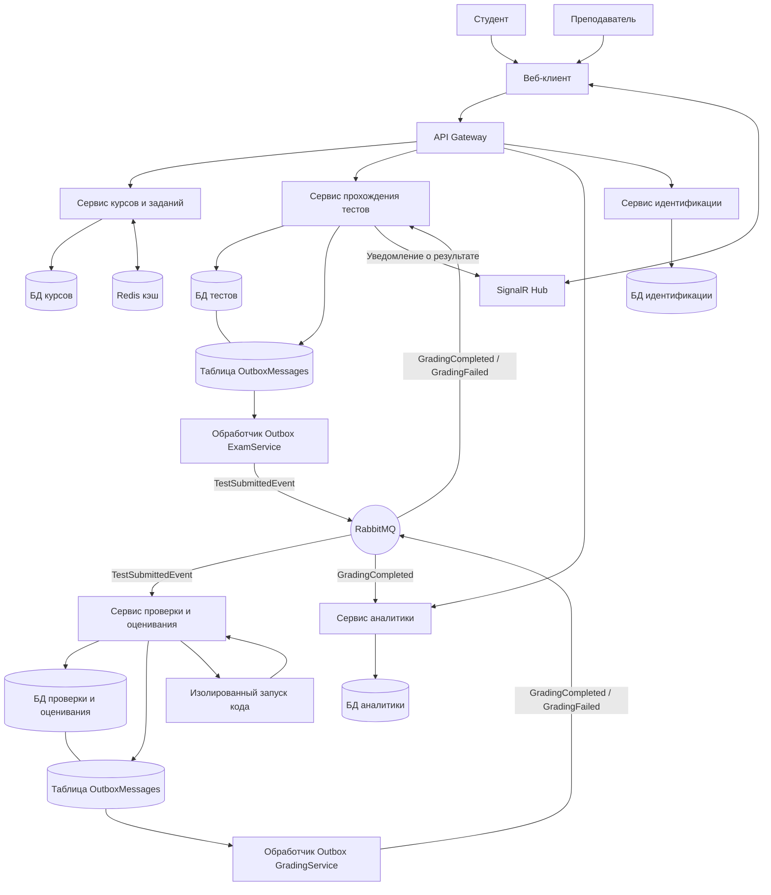
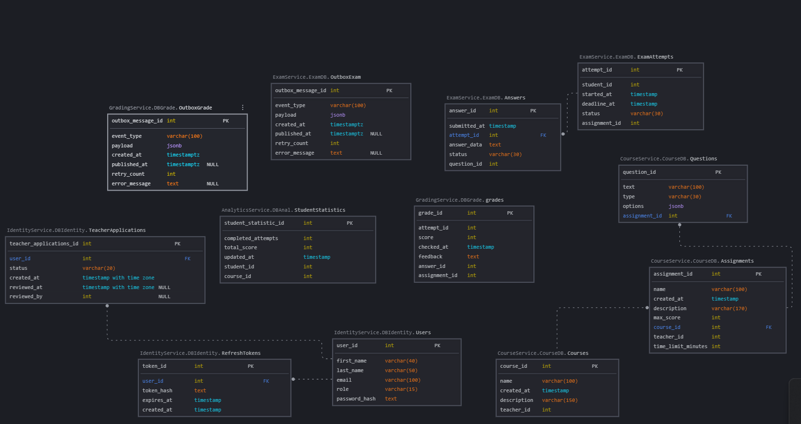

# Архитектура системы


## 1. Цель и контекст


Онлайн-тестирование и проверка заданий.

Система предназначена для автоматизации процесса обучения и контроля знаний в колледжах и университетах. Она решает задачу организации проверки знаний: преподаватели создают курсы, тесты и задания, а студенты проходят их в онлайн-формате.


## 2. Требования


Функциональные требования:

1\. Курсы и задания: преподаватель имеет возможность создавать курсы и задания для студентов, а студенты - изучать материал.

2\. Прохождение тестов: студент имеет возможность проходить тесты для проверки знаний и отправлять ответы на проверку, система должна обеспечивать контроль времени прохождения теста на серверной стороне.

3\. Проверка и оценивание: система должна проверять ответы студентов, рассчитывать оценку и сохранять результаты. Проверка должна поддерживать асинхронную обработку через RabbitMQ.

4\. Автопроверка кода: при наличии программного кода в задании система должна проверять код в изолированном процессе или контейнере.

5\. Аналитика: система должна собирать данные студента о результатах его тестов и составлять статистику успеваемости.

6\. Хранение данных: для каждого микросервиса должна быть своя база данных.

7\. Взаимодействие сервисов: синхронные HTTP-запросы от веб-клиента должны проходить через API Gateway. Асинхронный обмен заданиями на проверку и результатами проверки должен осуществляться через RabbitMQ.


Нефункциональные требования:

1\. Надежность: система должна корректно обрабатывать ошибки между микросервисами. Если сервис проверки временно недоступен, сообщения с заданиями на проверку должны оставаться в очереди RabbitMQ до возможности обработки.

2\. Безопасность: API должно поддерживать проверку JWT-токенов для защиты от несанкционированного доступа.

3\. Целостность данных: ответы студентов и результаты проверки должны сохраняться в соответствующих базах данных. Повторная обработка одного задания не должна создавать дублирующие результаты.

4\. Журналирование: система должна записывать основные события работы микросервисов и ошибки в журналы, чтобы облегчить поиск неисправностей.

5\. Контроль состояния: каждый микросервис должен предоставлять endpoint для проверки работоспособности.

6\. Развертывание: система должна запускаться с помощью Docker Compose. Инструкция по запуску должна быть описана в README.

7\. Тестируемость: основные функции системы должны проверяться автоматическими тестами, включая прохождение тестов, проверку ответов и обработку сообщений через RabbitMQ.


## 3. Общая схема





## 4. Описание сервисов


API-контракты микросервисов
Все приведённые ниже маршруты относятся к API соответствующих сервисов. Внешний клиент обращается к ним через API Gateway.
Формат запросов и ответов - JSON. Для защищённых эндпоинтов используется заголовок:
Authorization: Bearer <JWT>
Обозначения ролей:
•	Все авторизованные пользователи - пользователь с действительным JWT.
•	Student - студент.
•	Teacher - преподаватель.
•	Admin - администратор.
•	Без авторизации - endpoint доступен без JWT.
Во всех JSON-контрактах используется snake_case.

###CourseService

Ответственность
CourseService отвечает за управление курсами, заданиями и учебными материалами. Преподаватели могут создавать и редактировать курсы и задания, студенты -просматривать доступные материалы.
При создании курса сервис сохраняет идентификатор преподавателя, создавшего курс. При изменении курса или задания сервис проверяет, что запрос выполняет преподаватель, имеющий право на изменение соответствующего ресурса.

База данных: CourseDB.

Таблицы: Courses, Assignments, Questions.
Кэширование: Redis используется для кэширования часто запрашиваемых данных курсов. После изменения данных соответствующий кэш должен обновляться.
Публикуемые события: отсутствуют в текущем проектировании.
Потребляемые события: отсутствуют в текущем проектировании.

Основные эндпоинты
Метод	Endpoint	Назначение	Доступ
GET	/api/courses	Получить список курсов	Все авторизованные пользователи
GET	/api/courses/{id}	Получить курс	Все авторизованные пользователи
POST	/api/courses	Создать курс	Teacher
PUT	/api/courses/{id}	Изменить курс	Teacher
GET	/api/courses/{id}/assignments	Получить задания курса	Все авторизованные пользователи
POST	/api/courses/{id}/assignments	Создать задание в курсе	Teacher
GET	/api/assignments/{id}	Получить задание	Все авторизованные пользователи
PUT	/api/assignments/{id}	Изменить задание	Teacher
GET	/api/assignments/{id}/questions	Получить вопросы задания	Все авторизованные пользователи
POST	/api/assignments/{id}/questions	Создать вопрос в задании	Teacher
GET	/api/questions/{id}	Получить вопрос	Все авторизованные пользователи
PUT	/api/questions/{id}	Изменить вопрос	Teacher

Таблица Questions
Таблица Questions хранится в CourseDB и содержит вопросы, относящиеся к заданиям.
Поле	Тип	Назначение
question_id	int, PK	Идентификатор вопроса
assignment_id	int, FK	Идентификатор задания из Assignments
text	varchar	Текст вопроса
type	varchar	Тип вопроса, например SingleChoice или Code
options	jsonb или text	Варианты ответа или дополнительные данные вопроса
question_id используется для однозначного определения вопроса при сохранении ответа студента и последующей проверке. В других базах данных этот идентификатор хранится как логическая ссылка, без внешнего ключа между базами разных сервисов.

Контракты API
1. Получение списка курсов
GET /api/courses
Запрос не содержит тела.
Успешный ответ: 200 OK.
[
  {
    "id": 1,
    "name": "Основы программирования",
    "description": "Введение в программирование"
  }
]
Возможные ошибки: 401 Unauthorized - пользователь не авторизован.

2. Получение курса
GET /api/courses/{id}
Пример: GET /api/courses/1
Успешный ответ: 200 OK.
{
  "id": 1,
  "name": "Основы программирования",
  "description": "Введение в программирование"
}
Возможные ошибки: 401 Unauthorized, 404 Not Found.

3. Создание курса
POST /api/courses
Доступ: Teacher.
Тело запроса:
{
  "name": "Основы программирования",
  "description": "Введение в программирование"
}
Успешный ответ: 201 Created.
{
  "id": 1,
  "name": "Основы программирования",
  "description": "Введение в программирование"
}
Возможные ошибки: 400 Bad Request, 401 Unauthorized, 403 Forbidden.

4. Изменение курса
PUT /api/courses/{id}
Доступ: Teacher.
Тело запроса:
{
  "name": "Основы программирования",
  "description": "Обновлённое описание курса"
}
Успешный ответ: 200 OK.
{
  "id": 1,
  "name": "Основы программирования",
  "description": "Обновлённое описание курса"
}
Возможные ошибки: 400 Bad Request, 401 Unauthorized, 403 Forbidden, 404 Not Found.

5. Получение заданий курса
GET /api/courses/{id}/assignments
Успешный ответ: 200 OK.
[
  {
    "id": 1,
    "course_id": 1,
    "name": "Первая работа",
    "description": "Проверка базовых знаний",
    "time_limit_minutes": 30
  }
]
Возможные ошибки: 401 Unauthorized, 404 Not Found.

6. Создание задания
POST /api/courses/{id}/assignments
Доступ: Teacher.
Тело запроса:
{
  "name": "Первая работа",
  "description": "Проверка базовых знаний",
  "max_score": 100,
  "time_limit_minutes": 30
}
Успешный ответ: 201 Created.
{
  "id": 1,
  "course_id": 1,
  "name": "Первая работа",
  "description": "Проверка базовых знаний",
  "max_score": 100,
  "time_limit_minutes": 30
}
Возможные ошибки: 400 Bad Request, 401 Unauthorized, 403 Forbidden, 404 Not Found.

7. Получение задания
GET /api/assignments/{id}
Успешный ответ: 200 OK.
{
  "id": 1,
  "course_id": 1,
  "name": "Первая работа",
  "description": "Проверка базовых знаний",
  "max_score": 100,
  "time_limit_minutes": 30
}
Возможные ошибки: 401 Unauthorized, 404 Not Found.

8. Изменение задания
PUT /api/assignments/{id}
Доступ: Teacher.
Тело запроса:
{
  "name": "Первая работа",
  "description": "Обновлённое описание",
  "max_score": 100,
  "time_limit_minutes": 45
}
Успешный ответ: 200 OK.
{
  "id": 1,
  "course_id": 1,
  "name": "Первая работа",
  "description": "Обновлённое описание",
  "max_score": 100,
  "time_limit_minutes": 45
}
Возможные ошибки: 400 Bad Request, 401 Unauthorized, 403 Forbidden, 404 Not Found.

9. Получение вопросов задания
GET /api/assignments/{id}/questions
Успешный ответ: 200 OK.
[
  {
    "question_id": 1,
    "assignment_id": 1,
    "text": "Какой тип данных используется для целых чисел в C#?",
    "type": "SingleChoice",
    "options": [
      "int",
      "string",
      "bool"
    ]
  }
]
Возможные ошибки: 401 Unauthorized, 404 Not Found.

10. Создание вопроса
POST /api/assignments/{id}/questions
Доступ: Teacher.
Тело запроса:
{
  "text": "Какой тип данных используется для целых чисел в C#?",
  "type": "SingleChoice",
  "options": [
    "int",
    "string",
    "bool"
  ]
}
Успешный ответ: 201 Created.
{
  "question_id": 1,
  "assignment_id": 1,
  "text": "Какой тип данных используется для целых чисел в C#?",
  "type": "SingleChoice",
  "options": [
    "int",
    "string",
    "bool"
  ]
}
question_id генерируется сервером и не передаётся при создании вопроса.
Возможные ошибки: 400 Bad Request, 401 Unauthorized, 403 Forbidden, 404 Not Found.

11. Получение вопроса
GET /api/questions/{id}
Успешный ответ: 200 OK.
{
  "question_id": 1,
  "assignment_id": 1,
  "text": "Какой тип данных используется для целых чисел в C#?",
  "type": "SingleChoice",
  "options": [
    "int",
    "string",
    "bool"
  ]
}
Возможные ошибки: 401 Unauthorized, 404 Not Found.

12. Изменение вопроса
PUT /api/questions/{id}
Доступ: Teacher.
Тело запроса:
{
  "text": "Какой тип данных в C# используется для целых чисел?",
  "type": "SingleChoice",
  "options": [
    "int",
    "string",
    "bool"
  ]
}
Успешный ответ: 200 OK.
{
  "question_id": 1,
  "assignment_id": 1,
  "text": "Какой тип данных в C# используется для целых чисел?",
  "type": "SingleChoice",
  "options": [
    "int",
    "string",
    "bool"
  ]
}
Возможные ошибки: 400 Bad Request, 401 Unauthorized, 403 Forbidden, 404 Not Found.

###ExamService

Ответственность
ExamService отвечает за прохождение тестов: создание попыток, сохранение ответов, контроль времени и получение результатов проверки.
Время начала и окончания попытки фиксируется на сервере. Клиент не может самостоятельно продлить время прохождения.

База данных: ExamDB.

Публикуемые события:
•	TestSubmittedEvent - попытка отправлена на проверку.
Потребляемые события:
•	GradingCompleted - проверка завершена.
•	GradingFailed - при проверке произошла ошибка.

Основные эндпоинты
Метод	Endpoint	Назначение	Доступ
POST	/api/attempts	Начать попытку	Student
GET	/api/attempts/{id}	Получить состояние попытки	Владелец попытки или Teacher
POST	/api/attempts/{id}/answers	Сохранить ответ	Владелец попытки
POST	/api/attempts/{id}/submit	Отправить попытку на проверку	Владелец попытки
GET	/api/attempts/{id}/results	Получить результат	Владелец попытки или Teacher

Контракты API
1. Начало попытки
POST /api/attempts
Доступ: Student.
Тело запроса:
{
  "assignment_id": 1
}
Успешный ответ: 201 Created.
{
  "attempt_id": 1,
  "assignment_id": 1,
  "status": "InProgress",
  "started_at": "2026-10-23T10:00:00Z",
  "deadline_at": "2026-10-23T10:30:00Z"
}
student_id определяется по данным авторизованного пользователя, а не принимается как доверенное значение от клиента.
Возможные ошибки: 400 Bad Request, 401 Unauthorized, 403 Forbidden, 404 Not Found, 409 Conflict - если начать попытку в текущем состоянии нельзя.
2. Получение состояния попытки
GET /api/attempts/{id}
Успешный ответ: 200 OK.
{
  "attempt_id": 1,
  "assignment_id": 1,
  "status": "InProgress",
  "started_at": "2026-10-23T10:00:00Z",
  "deadline_at": "2026-10-23T10:30:00Z"
}
Возможные ошибки: 401 Unauthorized, 403 Forbidden, 404 Not Found.
3. Сохранение ответа
POST /api/attempts/{id}/answers
Доступ: владелец попытки.
Тело запроса:
{
  "question_id": 1,
  "answer_data": "int"
}
question_id указывает, на какой вопрос отвечает студент. answer_data содержит ответ. answer_id создаётся сервером и не передаётся клиентом.
Успешный ответ: 201 Created.
{
  "attempt_id": 1,
  "answer_id": 1,
  "question_id": 1,
  "saved": true
}
Возможные ошибки: 400 Bad Request, 401 Unauthorized, 403 Forbidden, 404 Not Found, 409 Conflict - если попытка уже завершена или время истекло.
В таблице Answers базы ExamDB должны храниться answer_id, attempt_id, question_id, answer_data, submitted_at и status. question_id является логической ссылкой на вопрос в CourseDB; внешний ключ между базами не создаётся.
4. Отправка попытки на проверку
POST /api/attempts/{id}/submit
Доступ: владелец попытки.
Тело запроса не требуется: ответы должны быть предварительно сохранены.
Успешный ответ: 202 Accepted.
{
  "attempt_id": 1,
  "status": "PendingGrading",
  "message": "Попытка отправлена на проверку"
}
Ответ 202 Accepted означает, что запрос принят в обработку, но проверка ещё не завершена.
Возможные ошибки: 401 Unauthorized, 403 Forbidden, 404 Not Found, 409 Conflict - если попытка уже отправлена или завершена.
После отправки ExamService сохраняет состояние попытки и событие TestSubmittedEvent в Outbox. Фоновый обработчик передаёт событие в RabbitMQ.
5. Получение результата
GET /api/attempts/{id}/results
Успешный ответ после завершения проверки: 200 OK.
{
  "attempt_id": 1,
  "status": "Completed",
  "score": 85,
  "feedback": "Работа проверена"
}
Если проверка ещё выполняется, возвращается 200 OK с текущим состоянием:
{
  "attempt_id": 1,
  "status": "PendingGrading",
  "score": null,
  "feedback": null
}
Возможные ошибки: 401 Unauthorized, 403 Forbidden, 404 Not Found.
Событие TestSubmittedEvent
ExamService публикует событие после отправки попытки на проверку.
Пример содержимого:
{
  "event_id": 1,
  "attempt_id": 1,
  "student_id": 1,
  "assignment_id": 1,
  "submitted_at": "2026-10-23T10:25:00Z",
  "answers": [
    {
      "answer_id": 1,
      "question_id": 1,
      "answer_data": "int"
    }
  ]
}
event_id используется для идентификации события и защиты от повторной обработки. question_id позволяет GradingService определить, к какому вопросу относится каждый ответ. Формат сообщения является проектируемым контрактом и может быть расширен данными, необходимыми для проверки.

###GradingService

Ответственность
GradingService выполняет автоматическую проверку ответов, рассчитывает оценку и сохраняет результаты проверки. Для заданий с программным кодом предусматривается запуск кода в изолированной среде.

База данных: DBGrade.

Публикуемые события:
•	GradingCompleted - проверка завершена.
•	GradingFailed - проверка завершилась ошибкой.

Потребляемые события:
•	TestSubmittedEvent - попытка отправлена на проверку.

Публичные HTTP-эндпоинты для проверки в текущем проектировании не предусмотрены. Основной способ получения заданий на проверку - RabbitMQ.

Событие GradingCompleted
Пример содержимого:
{
  "event_id": 2,
  "attempt_id": 3,
  "student_id": 4,
  "assignment_id": 3,
  "status": "Completed",
  "score": 85,
  "feedback": "Работа проверена",
  "completed_at": "2026-10-23T10:26:00Z"
}
Событие используется ExamService для обновления состояния попытки, а AnalyticsService - для обновления статистики.

Событие GradingFailed
Пример содержимого:
{
  "event_id": 3,
  "attempt_id": 1,
  "student_id": 3,
  "assignment_id": 4,
  "status": "Failed",
  "error_code": "GRADING_ERROR",
  "message": "Не удалось завершить проверку"
}

GradingService сохраняет результат проверки в DBGrade, после чего публикует соответствующее событие через Outbox. Обработчики сообщений должны учитывать повторную доставку событий.
В базе DBGrade таблица Grades хранит результаты проверки. Если требуется сохранять результат по каждому отдельному ответу, в записи оценки используется answer_id. Идентификаторы attempt_id, assignment_id и answer_id являются логическими ссылками на данные других сервисов.
Для запуска пользовательского кода предусматривается изолированная среда выполнения с ограничениями ресурсов и доступа. Пользовательский код не должен выполняться непосредственно внутри основного процесса GradingService.

###AnalyticsService

Ответственность
AnalyticsService собирает статистику успеваемости студентов, рассчитывает агрегированные показатели и предоставляет данные о прогрессе обучения.

База данных: DBAnal.

Публикуемые события: отсутствуют в текущем проектировании.

Потребляемые события:
•	GradingCompleted - для обновления статистики.

Основные эндпоинты
Метод	Endpoint	Назначение	Доступ
GET	/api/analytics/students/{student_id}	Получить статистику студента	Сам студент или Teacher
GET	/api/analytics/courses/{course_id}	Получить статистику курса	Teacher

Контракты API
1. Статистика студента
GET /api/analytics/students/{student_id}
Успешный ответ: 200 OK.
{
  "student_id": 1,
  "completed_attempts": 10,
  "total_score": 820,
  "average_score": 82,
  "updated_at": "2026-10-23T10:26:00Z"
}
Возможные ошибки: 401 Unauthorized, 403 Forbidden, 404 Not Found.
2. Статистика курса
GET /api/analytics/courses/{course_id}
Успешный ответ: 200 OK.
{
  "course_id": 1,
  "completed_attempts": 45,
  "average_score": 78,
  "updated_at": "2026-10-23T10:26:00Z"
}
Возможные ошибки: 401 Unauthorized, 403 Forbidden, 404 Not Found.
Статистика может обновляться с задержкой, поскольку AnalyticsService обрабатывает события асинхронно. В DBAnal хранятся агрегированные данные, необходимые для построения отчётов.

###IdentityService

Ответственность

IdentityService отвечает за регистрацию пользователей, проверку учётных данных, аутентификацию, выдачу JWT и управление ролями.

База данных: DBIdentity.

Публикуемые события: отсутствуют в текущем проектировании.

Потребляемые события: отсутствуют в текущем проектировании.

Основные эндпоинты
Метод	Endpoint	Назначение	Доступ
POST	/api/auth/register	Регистрация пользователя	Без авторизации
POST	/api/auth/login	Вход пользователя	Без авторизации
POST	/api/auth/refresh	Обновление токенов	По действительному refresh-токену
GET	/api/users	Получение списка пользователей	Admin
GET	/api/users/{id}	Получение информации о пользователе	Сам пользователь или Admin
GET	/api/teacher-applications	Получение списка заявок на роль преподавателя	Admin
POST	/api/teacher-applications/{id}/approve	Одобрить заявку на роль преподавателя	Admin
POST	/api/teacher-applications/{id}/reject	Отклонить заявку на роль преподавателя	Admin

Контракты API
1. Регистрация
POST /api/auth/register
Доступ: без авторизации.
Тело запроса:
{
  "first_name": "Анна",
  "last_name": "Макарова",
  "email": "teacher@example.com",
  "password": "ExamplePassword123",
  "requested_role": "Teacher"
}
Поле requested_role может принимать значения Student или Teacher. При запросе роли Student сервер назначает пользователю роль Student. При запросе роли Teacher сервер создаёт заявку со статусом Pending, а пользователь до одобрения заявки не получает права преподавателя.
Успешный ответ: 201 Created.
{
  "user_id": 1,
  "email": "teacher@example.com",
  "requested_role": "Teacher",
  "teacher_application_status": "Pending"
}
В этом примере пользователь ещё не получил роль преподавателя. Поле teacher_application_status показывает состояние заявки.
Пароль не возвращается в ответе и хранится в базе данных только в виде безопасного хеша.
Возможные ошибки: 400 Bad Request - некорректные данные; 409 Conflict - пользователь с таким email уже зарегистрирован.
2. Вход
POST /api/auth/login
Доступ: без авторизации.
Тело запроса:
{
  "email": "student@example.com",
  "password": "ExamplePassword123"
}
Успешный ответ: 200 OK.
{
  "access_token": "<JWT>",
  "refresh_token": "<refresh-token>",
  "token_type": "Bearer",
  "expires_in": 3600
}
Возможные ошибки: 400 Bad Request, 401 Unauthorized - если учётные данные неверны.
3. Обновление токенов
POST /api/auth/refresh
Доступ: по действительному refresh-токену.
Тело запроса:
{
  "refresh_token": "<refresh-token>"
}
Успешный ответ: 200 OK.
{
  "access_token": "<new-JWT>",
  "refresh_token": "<new-refresh-token>",
  "token_type": "Bearer",
  "expires_in": 3600
}
Возможные ошибки: 400 Bad Request, 401 Unauthorized - если refresh-токен недействителен, отозван или просрочен.
4. Получение списка пользователей
GET /api/users
Доступ: Admin.
Успешный ответ: 200 OK.
[
  {
    "user_id": 1,
    "first_name": "Анна",
    "last_name": "Макарова",
    "email": "student@example.com",
    "role": "Student"
  }
]
Возможные ошибки: 401 Unauthorized, 403 Forbidden.
5. Получение пользователя
GET /api/users/{id}
Доступ: сам пользователь или Admin.
Успешный ответ: 200 OK.
{
  "user_id": 1,
  "first_name": "Анна",
  "last_name": "Макарова",
  "email": "student@example.com",
  "role": "Student"
}
Возможные ошибки: 401 Unauthorized, 403 Forbidden, 404 Not Found.
6. Получение списка заявок преподавателей
GET /api/teacher-applications
Доступ: Admin.
Успешный ответ: 200 OK.
[
  {
    "teacher_application_id": 1,
    "user_id": 1,
    "status": "Pending",
    "created_at": "2026-10-23T10:00:00Z",
    "reviewed_at": null,
    "reviewed_by": null
  }
]
Возможные ошибки: 401 Unauthorized, 403 Forbidden.
7. Одобрение заявки преподавателя
POST /api/teacher-applications/{id}/approve
Доступ: Admin.
Тело запроса не требуется.
Успешный ответ: 200 OK.
{
  "teacher_application_id": 1,
  "user_id": 1,
  "status": "Approved"
}
После одобрения заявки пользователь получает права преподавателя.
Возможные ошибки: 401 Unauthorized, 403 Forbidden, 404 Not Found, 409 Conflict - если заявку нельзя обработать в текущем состоянии.
8. Отклонение заявки преподавателя
POST /api/teacher-applications/{id}/reject
Доступ: Admin.
Тело запроса не требуется.
Успешный ответ: 200 OK.
{
  "teacher_application_id": 1,
  "user_id": 1,
  "status": "Rejected"
}
Возможные ошибки: 401 Unauthorized, 403 Forbidden, 404 Not Found, 409 Conflict -  если заявку нельзя обработать в текущем состоянии.


## 5. Модель данных





## 6. Взаимодействие сервисов


В системе используются синхронное взаимодействие по HTTP и асинхронный обмен событиями через RabbitMQ.

Веб-клиент отправляет HTTP-запросы через API Gateway. Gateway направляет запросы в соответствующие сервисы:


CourseService - получение курсов и заданий

ExamService - начало тестирования, сохранение ответов и отправка теста на проверку

AnalyticsService - получение статистики

IdentityService - регистрация, вход и получение данных для аутентификации


Каждый сервис работает со своей базой данных.

Проверка отправленных тестов выполняется асинхронно с помощью RabbitMQ.

1\. ExamService сохраняет ответы и информацию об отправке теста в ExamDB.

2\. Событие TestSubmittedEvent записывается в таблицу OutboxMessages.

3\. Фоновый обработчик отправляет событие в RabbitMQ.

4\. GradingService получает событие, проверяет ответы и сохраняет результат в GradeDB.

5\. GradingService публикует событие GradingCompleted или GradingFailed через свой Outbox.

6\. ExamService обновляет статус попытки, а AnalyticsService использует полученный результат для обновления статистики.

7\. После завершения проверки клиент может получить уведомление через SignalR Hub.


```mermaid

sequenceDiagram

&#x20;   actor Student as Студент

&#x20;   participant Client as Веб-клиент

&#x20;   participant Exam as ExamService

&#x20;   participant MQ as RabbitMQ

&#x20;   participant Grade as GradingService

&#x20;   participant SignalR as SignalR Hub


&#x20;   Student->>Client: Отправить тест

&#x20;   Client->>Exam: Передать ответы

&#x20;   Exam->>Exam: Сохранить ответы

&#x20;   Exam-->>Client: Тест принят


&#x20;   Exam->>MQ: TestSubmittedEvent

&#x20;   MQ->>Grade: Передать тест

&#x20;   Grade->>Grade: Проверить ответы

&#x20;   Grade->>MQ: GradingCompleted

&#x20;   MQ->>Exam: Передать результат

&#x20;   Exam->>Exam: Обновить статус попытки

&#x20;   Exam->>SignalR: Уведомить о готовности результата

&#x20;   SignalR-->>Client: Результат готов

```

## 7. Безопасность


Для защиты системы предусмотрены следующие механизмы:


Аутентификация: IdentityService отвечает за вход пользователя и проверку его учётных данных.

Хранение паролей: в базе данных хранится хеш пароля, а не исходный пароль.

Роли: предусмотрены роли Student и Teacher. Доступ к операциям ограничивается в зависимости от роли пользователя.

Защита API: защищённые запросы должны проверять токен аутентификации и права пользователя.

Защита данных: каждый микросервис имеет собственную базу данных. Между сервисами передаются необходимые идентификаторы и данные событий.

Изоляция запуска кода: пользовательский код запускается в изолированной среде, чтобы ограничить его воздействие на систему.


\## 8. Развёртывание и конфигурация


Система планируется к запуску с помощью Docker Compose. В состав окружения входят веб-клиент, API Gateway, IdentityService, CourseService, ExamService, GradingService, AnalyticsService, RabbitMQ и базы данных микросервисов.

Каждый микросервис использует собственную базу данных. Прямой доступ одного сервиса к базе данных другого не предусмотрен.

Адреса, порты и строки подключения будут указаны в docker-compose.yml и конфигурационных файлах сервисов после настройки запуска.

Конфиденциальные параметры, такие как JWT-ключ и пароли баз данных, будут передаваться через переменные окружения.

Для контроля состояния сервисов и баз данных планируется настроить health checks. RabbitMQ Management UI будет использоваться для просмотра состояния очередей и сообщений во время разработки.


## 9. Принятые решения


| Решение | Альтернативы | Причина выбора |

| 1. Передавать отправленные тесты в GradingService через RabbitMQ | Выполнять проверку непосредственно в HTTP-запросе| Асинхронная обработка позволяет не заставлять студента ждать завершения проверки в рамках одного запроса| 

| 2. Использовать SignalR для уведомления клиента о готовности результата проверки | Использовать периодические запросы клиента к серверу | Это позволяет сообщать клиенту о готовности результата без постоянных запросов |

| 3. Использовать Outbox для публикации событий | Отправлять сообщения непосредственно в RabbitMQ после сохранения данных | Outbox снижает риск потери события при сбое между сохранением данных и отправкой сообщения |


## 10. Ограничения и развитие


Ограничения:

На этапе проектирования сервисы и их взаимодействие описаны концептуально; работоспособность системы будет проверена после реализации.

Что можно улучшить:
-

